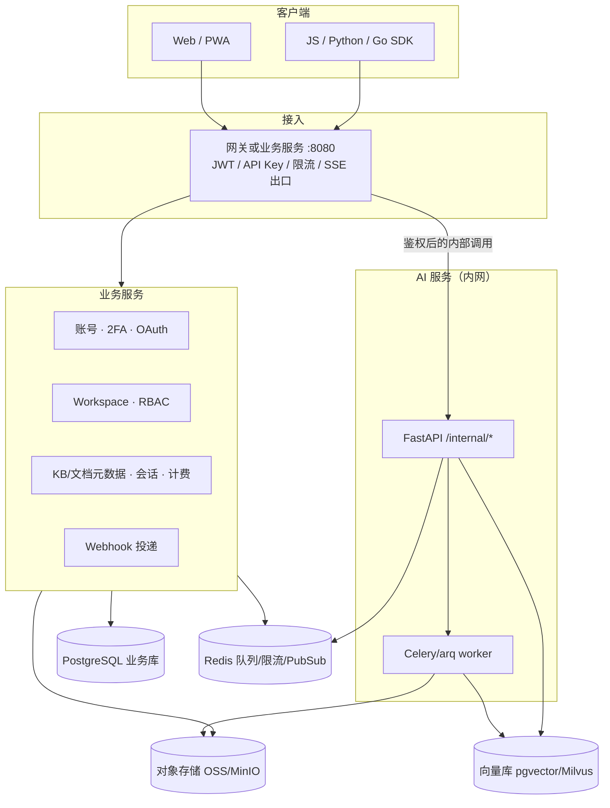

# 服务拆分实施手册（国内常见三层）

> 本文给出把当前 Next.js 单体拆成「业务服务 + Python AI 服务 + 前端」的可执行计划：每个阶段的工作拆分、接口、回滚与验收标准。当前生产架构仍以[总体架构](overview.md)为准；未完成对应阶段前，不要在运行时启用拆分路径。
>
> AI 辅助编写，已人工校核。

阅读后你应能：按阶段开工、按清单验收、在任一步失败时回滚到上一阶段仍可用的单体（或上一稳定切面）。

## 背景与前置条件

当前系统是单仓库全栈：页面与 API 同在 Next.js 16 进程，[读路径以内存 Store 为事实源](adr/adr-0001-in-memory-store-write-through-db.md)，文档处理与 Agent 走[后台队列](adr/adr-0002-background-job-queue.md)，RAG 在 `src/lib/rag/`，租户边界是 [Workspace](adr/adr-0003-multi-tenant-isolation.md)。

国内常见拆法：

| 层 | 建议实现 | 承接现有模块 |
|----|----------|----------------|
| 前端 | 继续 React + TypeScript（不必为对齐国内而重写 Vue） | `src/app/(app)`、`src/components/` |
| 业务服务 | Java 17+ Spring Boot，或 Go | `auth/` `workspace/` `team/` `billing/` `kb/`（元数据）`chat/`（会话）`apikeys/` `webhooks/`（投递）`proxy.ts`（限流） |
| AI 服务 | Python 3.12 + FastAPI + 独立 worker | `rag/` `llm/` `kg/` `external/` `agent/` |

前置：

- 已能 `pnpm dev` 走通登录 → 上传 → 问答；`pnpm lint` 与受影响测试可跑；
- 已阅读 [RAG 引擎](rag-engine.md)、[Agent 编排](agent-orchestration.md)、[部署指南](../ops/deployment-guide.md)；
- 冻结对外合同：现有 `/api/v1/*` 路径、SSE 事件名（`sources` / `token` / `done`；Agent 的 `init` / `step` / `done` / `error` / `end`）、API Key scope 在拆分期间**不得改名**。

两条实施轨道（选一条写进阶段计划，不要混用工期）：

| 轨道 | 做到哪一阶段 | 适用 |
|------|----------------|------|
| 简历 / 学习 | 阶段 0～3 完成即可演示「Python RAG + 现有 Next BFF」 | AI 应用 / 全栈岗 |
| 生产 / Java 岗 | 做到阶段 4～6 | 国内 ToB、多实例、Java 后端简历 |

## 目标架构



**不可谈判的契约**（全程有效，写入每阶段验收）：

1. 浏览器只打业务入口（现有 Next 或拆出后的业务服务）。Python **不对公网**。
2. 调 AI 时由业务侧注入已校验的 `workspaceId` / `userId` / `kbId`。Python 不得自行解析用户 JWT 去列知识库。
3. 文件走对象存储；禁止再依赖 app 与 worker 共享 `.uploads` 本地卷作为跨进程协议。
4. SSE 事件名与 `/api/v1` 对外路径保持兼容，直到单独做 API 大版本。
5. 向量检索与权限校验都必须带 `workspace_id`，与 [ADR-0003](adr/adr-0003-multi-tenant-isolation.md) 一致。

## 阶段总览

| 阶段 | 名称 | 退出后的系统形态 | 建议工期（1 人） | 轨道 |
|------|------|------------------|------------------|------|
| 0 | 冻结合同与基线 | 仍是单体；有基线报告与特性开关 | 3～5 天 | 两条都要 |
| 1 | 绞杀：Python RAG | Next 仍对外；索引与问答生成走 Python | 2～4 周 | 两条都要 |
| 2 | 对象存储 | 上传直传 MinIO/OSS；worker 按 URL 拉取 | 1～2 周 | 两条都要 |
| 3 | AI 侧租户硬化 | 向量表带 `workspace_id`；越权检索失败 | 1 周 | 两条都要 |
| 4 | 拆业务服务 | Java/Go 接管鉴权与元数据；废弃内存读路径 | 4～12 周 | 生产轨道 |
| 5 | Agent 与 Webhook | Agent 在 Python；进度经 Redis；Webhook 仍由业务投递 | 2～4 周 | 生产轨道 |
| 6 | 前端解耦与多实例 | Next 可改为纯静态；多副本 + 网关 | 2～4 周 | 生产轨道 |

阶段必须**串行**。未关闭上一阶段验收清单，不得开始下一阶段。每个阶段结束必须能演示主路径，并保留回滚开关。

全局回滚原则：每个阶段用环境变量切换（如 `AI_SERVICE_URL` 空则走进程内 `src/lib/rag`）。开关默认关；验收通过后再在演示环境打开。

---

## 阶段 0：冻结合同与基线

### 目标

在改架构前留下可对比的基线，避免拆分后「行为变了但说不清」。

### 范围

**做**：对外 API 快照、SSE 事件契约测试、关键用例录屏或 e2e、特性开关骨架、内部错误码表。  
**不做**：新建 Python 仓库、改 schema、改前端。

### 工作拆分

| ID | 工作包 | 产出 | 对应现有代码 |
|----|--------|------|----------------|
| 0.1 | 导出 `/api/v1` 合同 | 将 `src/lib/openapi/spec.ts` 冻结为 `docs/architecture/assets/v1-freeze-openapi.json`（目录需新建；或 CI 已有 OpenAPI 漂移检查的基线 tag） | `src/lib/openapi/spec.ts` |
| 0.2 | SSE 黄金事件 | 固定问答帧序 `sources → token* → done`；Agent `init → step* → done → end` | `src/lib/chat/ask.ts`、`src/app/api/chat`、`src/app/api/agent/run` |
| 0.3 | 主路径基线 | 跑 `e2e/main-flow.spec.ts` + `scripts/smoke` 的 http/lib 组，把报告存档 | `e2e/`、`scripts/smoke/` |
| 0.4 | 特性开关 | 增加 `AI_SERVICE_URL`、`AI_INTERNAL_TOKEN`（未设置 = 旧路径） | `src/lib/config.ts`、`.env.example`、[环境变量文档](../ops/env-vars.md) |
| 0.5 | 跨租户负例基线 | 用两个 workspace 的用户交叉读 KB / 检索，记录当前必须 403/空结果 | `canViewKb` / ADR-0003 |
| 0.6 | 观测基线 | 记下 `/api/health`、`/api/health/ready` 字段；拆分后字段只增不改名 | `src/lib/health/` |

### 验收标准

| 编号 | 类型 | 标准 | 验证方法 |
|------|------|------|----------|
| A0.1 | 功能 | 主路径 e2e 全绿（登录→上传→问答→Agent） | `pnpm test:e2e` |
| A0.2 | 合同 | OpenAPI 与 `spec.ts` 无漂移 | CI `docs` job 既有检查 |
| A0.3 | 合同 | 问答 SSE 事件名未改；测试断言仍通过 | `tests/api/api-test.mjs` 或对应 smoke |
| A0.4 | 配置 | `AI_SERVICE_URL` 未设置时行为与拆分前字节级一致（同一 e2e） | 开关关闭回归 |
| A0.5 | 安全 | 跨租户负例与文档记录一致 | 手工或脚本：用户 B 访问用户 A 的 `kbId` → 403 |
| A0.6 | 退出 | 基线报告（测试日志 + OpenAPI hash）纳入版本管理或内部 wiki | 评审勾选 |

**退出**：A0.1～A0.6 全通过。失败则停在单体，不进入阶段 1。

---

## 阶段 1：绞杀式抽出 Python RAG

### 目标

文档索引与问答生成在 Python 中执行；Next 仍是唯一公网入口（BFF）。用户无感。

### 范围

**做**：FastAPI `index` / `retrieve` / `chat/stream`；Next 的 `doc-process` handler 与 `handleChatRequest` 在开关打开时改调 Python。  
**不做**：Java/Go、改上传存储、拆 Agent、删内存 Store。

### 工作拆分

| ID | 工作包 | 说明 |
|----|--------|------|
| 1.1 | 新建 `services/ai/`（或独立仓库） | FastAPI、uvicorn、pyproject.toml、Dockerfile（框架选型见 [ADR-0008](adr/adr-0008-ai-service-framework.md)） |
| 1.2 | 移植解析/切片 | 对齐 `parser.ts` / `chunker.ts` 的格式集合（PDF/Word/MD/TXT/CSV 文本类先做；Excel/HTML 次之；OCR/PPT 标迭代 1b） |
| 1.3 | 嵌入与向量 | 默认 pgvector；`EMBEDDING_*` 与现网模型名对齐，避免新旧索引混用 |
| 1.4 | 混合检索 | 向量 + BM25 + 重排；返回结构对齐现有 `RetrievedChunk`（id/text/score/docId/source） |
| 1.5 | 流式生成 | OpenAI 兼容网关（DeepSeek / 通义 / 硅基流动）；SSE 帧转成与现网相同的 `event:` 名 |
| 1.6 | Next 适配器 | `src/lib/rag/remote.ts`：开关打开则 HTTP 调 Python；失败可降级或 503（选定一种并写进 runbook） |
| 1.7 | 队列 | `doc-process` 仍由现有 worker 消费，handler 内部调 Python `POST /internal/index`（同步或再投 Python 队列，二选一，推荐 Python 侧再入队以免占 Node worker） |
| 1.8 | compose | 增加 `ai` 服务，仅绑定内网；Next `AI_SERVICE_URL=http://ai:8000` |

### 内部接口（仅 BFF 可调）

鉴权：请求头 `X-Internal-Token: <AI_INTERNAL_TOKEN>`。缺 token → 401。

```http
POST /internal/index
Content-Type: application/json

{
  "workspaceId": "<ws_...>",
  "kbId": "<kb_...>",
  "docId": "<doc_...>",
  "filename": "<file.pdf>",
  "mime": "application/pdf",
  "source": { "type": "url", "url": "<http://minio/... 或 file:// 过渡>" },
  "settings": { "chunkSize": 512, "chunkOverlap": 64 }
}
```

预期输出：`{"ok":true,"chunks":<n>}`；失败 `{"ok":false,"code":"parse_error","message":"..."}`（`message` 经脱敏，禁止回传密钥）。

```http
POST /internal/retrieve
```

Body：`workspaceId`、`kbId`、`query`、`topK`。返回 `chunks[]`。

```http
POST /internal/chat/stream
```

Body：`workspaceId`、`kbId`、`conversationId`、`messages`、`settings`。响应 `text/event-stream`，事件名 `sources` / `token` / `done`。

### 降级策略（阶段 1 必须写死一种）

推荐：**Python 不可用 → 问答 503 + Retry-After，不静默回退本地哈希 RAG**（避免「有时准有时胡编」）。索引任务进死信，文档状态保持 `processing`/`failed`。

### 验收标准

| 编号 | 类型 | 标准 | 验证方法 |
|------|------|------|----------|
| A1.1 | 功能 | 开关打开后，上传一份 Markdown，文档状态变为 ready | UI 或 `GET` KB 文档列表 |
| A1.2 | 功能 | 对该文档提问，SSE 仍为 `sources → token → done`，答案含引用 | 浏览器或 `curl -N` |
| A1.3 | 合同 | SDK / `/api/v1/chat` 路径不变 | 现有 `scripts/smoke/test-sdk.ts` |
| A1.4 | 隔离 | 无 `X-Internal-Token` 调 Python → 401；从宿主机端口映射应默认关闭 | `curl http://127.0.0.1:8000/internal/retrieve` |
| A1.5 | 隔离 | 直连 Python 即使用户 JWT 也不能列 KB | 负例脚本 |
| A1.6 | 观测 | Next 日志带 `requestId`；Python 日志带同一 `X-Trace-Id` | 抽样两条日志 |
| A1.7 | 失败 | 停掉 `ai` 容器后问答返回可重试错误，不 500 HTML | `docker stop` 后提问 |
| A1.8 | 回归 | `AI_SERVICE_URL` 清空后 e2e 仍绿（回滚） | 关开关重跑 e2e |
| A1.9 | 性能 | 同硬件下 P95 问答首 token 不超过基线 2 倍（阶段 1 允许变慢） | 对基线笔记对比 |

**退出**：A1.1～A1.8 必须；A1.9 记录即可。OCR/PPT 未迁移须在文档中列为已知限制，不得在演示时假装支持。

---

## 阶段 2：对象存储替代共享磁盘

### 目标

上传与解析不再共享容器本地 `.uploads`。多机部署的前提从此成立。

### 范围

**做**：MinIO（本地）/ S3 兼容 OSS；分片上传 complete 后只存 `objectKey`；AI worker 用预签名 GET 拉对象。  
**不做**：改 RBAC、拆 Java。

### 工作拆分

| ID | 工作包 | 说明 |
|----|--------|------|
| 2.1 | 存储配置 | `S3_ENDPOINT` `S3_BUCKET` `S3_ACCESS_KEY` `S3_SECRET_KEY`；compose 加 `minio`；同步 `.env.example` 与[环境变量文档](../ops/env-vars.md)（env parity 为 CI 门禁） |
| 2.2 | 上传链路 | 复用 `src/lib/upload/` 与 `src/lib/storage/`：complete 时写 `objectKey`，本地落盘仅作未开 S3 的回退 |
| 2.3 | 索引入参 | `/internal/index` 的 `source.type` 只允许 `s3`（bucket+key）或 `presignedUrl`（短 TTL） |
| 2.4 | 权限 | 预签名 PUT/GET TTL ≤ 15 分钟；bucket 私有 |
| 2.5 | 清理 | 删文档时业务侧删对象 + 调 `DELETE /internal/index/{docId}` |
| 2.6 | 下线共享卷 | compose 中 app/worker/ai **不再**为解析链路依赖同一 `uploads` 卷（可暂留空目录以免旧代码崩，但验收按「不读共享卷」） |

### 验收标准

| 编号 | 类型 | 标准 | 验证方法 |
|------|------|------|----------|
| A2.1 | 功能 | 分片上传完成后 MinIO 控制台可见对象 | 上传 ≥ 5MB 文件 |
| A2.2 | 功能 | AI worker 无共享卷时仍能索引成功 | 去掉 uploads 挂载后重试 2.1 |
| A2.3 | 安全 | 对象 URL 未配置时不可公网匿名下载 | 无签名 GET → 403 |
| A2.4 | 安全 | 预签名过期后 GET 失败 | 把 TTL 调到 5s 后重试 |
| A2.5 | 数据 | 删除文档后对象与向量均不存在 | 删文档后列 bucket + retrieve 为空 |
| A2.6 | 回归 | 未配 S3 时本地回退仍可用（若保留）或启动失败并明确报错（若生产禁止回退） | 两种模式写进 env 文档并测一种「官方」路径 |
| A2.7 | 运维 | 备份说明：Postgres + bucket 缺一不可恢复知识库 | runbook 一节 |

**退出**：A2.1～A2.5、A2.7 通过。生产配置必须禁止「只配 DB 不配 bucket」。

---

## 阶段 3：AI 侧租户硬化

### 目标

即使业务服务 bug 传错 `kbId`，Python 层也不会把 A 租户的 chunk 拼进 B 租户的上下文。纵深防御。

### 范围

**做**：向量/BM25 索引主键含 `workspace_id`；所有 retrieve/index/delete 强制过滤；越权测试。  
**不做**：拆业务进程。

### 工作拆分

| ID | 工作包 | 说明 |
|----|--------|------|
| 3.1 | schema | chunk 元数据：`workspace_id` `kb_id` `doc_id` 必填；查询 WHERE 三者（至少 workspace+kb） |
| 3.2 | 拒绝空租户 | `workspaceId` 缺失或空串 → 400，禁止默认 `ws_default` |
| 3.3 | 双写校验 | BFF 调 Python 前已 `canViewKb(user, kb, workspaceId)`；Python 再校验 body 内三元组与索引一致 |
| 3.4 | 负例套件 | 固定夹具：wsA/kbA、wsB/kbB，交叉 retrieve 必须空且不 500 |
| 3.5 | GraphRAG | 若启用 `kg/`，实体表同样带 `workspace_id`，1-hop 不得跨库 |

### 验收标准

| 编号 | 类型 | 标准 | 验证方法 |
|------|------|------|----------|
| A3.1 | 安全 | 用 wsB 的内部 token 检索 kbA → 0 hits | 自动化测试锁定 |
| A3.2 | 安全 | index 时 workspace 与 kb 归属不一致 → 400 | 单测 |
| A3.3 | 安全 | 缺 `workspaceId` → 400，不写入 | 单测 |
| A3.4 | 功能 | 同租户问答结果与阶段 1 无显著差异（引用仍指向本 KB 文档） | 对比同一问题 |
| A3.5 | 回归 | ADR-0003 相关权限测试仍绿 | 现有 team/kb 单测 |

**退出**：A3.1～A3.3 必须自动化并纳入 CI（可放 `services/ai/tests/`）。此阶段完成即「简历轨道」可交付演示。

---

## 阶段 4：拆出业务服务（Java 或 Go）

### 目标

鉴权、租户、KB 元数据、会话、计费、限流离开 Next 进程。**删除内存 Store 读路径**，PostgreSQL 成为业务读事实源。

### 范围

**做**：业务服务实现现有 `/api/v1` 与浏览器所需的 session API；Next 仅 SSR/静态或反向代理；hydrate/persist 不再承担生产读。  
**不做**：用 Vue 重写 UI（放到阶段 6 可选）。

### 语言选择（开工前写进 ADR）

**已选定：Java 17 + Spring Boot 3**（[ADR-0009](adr/adr-0009-business-service-language.md)，2026-10-13）：目标「生产 / Java 岗」轨道 + 国内 ToB 主流；组件映射、密码/JWT 逐字节兼容契约、Flyway baseline 策略均记录在该 ADR。Go 备选未采纳。

| 选择 | 何时 |
|------|------|
| Spring Boot 3 + Spring Security | 投国内 Java 岗或公司已是 Java（**本仓库已选定**） |
| Go + 标准库/chi | 希望与现有 TS 心智接近、运维简单 |
| 禁止 | 业务服务再用一套内存 map 当读事实源 |

### 工作拆分

| ID | 工作包 | 迁移来源 | 说明 |
|----|--------|----------|------|
| 4.1 | 身份 | `src/lib/auth/` `apikeys/` `security/totp` | JWT 签发、API Key 哈希、2FA；密钥比较恒定时间 |
| 4.2 | 租户与 RBAC | `workspace/` `team/` `roles.ts` | `canViewKb` 等签名保持「workspace 必填」 |
| 4.3 | KB 元数据 | `kb/store.ts` 非索引部分 | 文档状态机：uploaded → processing → ready/failed |
| 4.4 | 会话 | `chat/store.ts` | 消息落库；SSE 只转发 AI 流，落库仍在业务侧 |
| 4.5 | 计费用量 | `billing/` | 计量在业务服务；问答成功回调 `recordQa` |
| 4.6 | 限流 | `src/proxy.ts` `rate-limit.ts` | 网关或 Spring Filter；维度与现网一致（anon/user/apikey/kb） |
| 4.7 | 读路径 | 删除生产路径对 `globalThis.__KAI_*_STORE__` 的依赖 | Redis 仅缓存会话/限流，不作 KB 权限唯一来源 |
| 4.8 | 适配 AI | 业务服务持有 `AI_INTERNAL_TOKEN` | 打开 chat 时先鉴权再 stream pipe |
| 4.9 | 数据迁移 | Prisma schema → Flyway/Liquibase 或保持 Postgres 由业务服务 migrate | 一次切换窗口；先 `migrate deploy` 再切流量 |
| 4.10 | 下线 Next API | `src/app/api/**` 变为 301 到业务服务或删除 | 前端 `NEXT_PUBLIC_API_BASE` 指向业务服务 |

### 切换步骤（生产窗口）

> 部署时操作的执行手册（预检清单 / 逐步操作 / 验证清单 / 回滚预案）已沉淀至 [部署指南「生产切换窗口（4.10）」](../ops/deployment-guide.md)；本节保留决策要点。

1. 业务服务只读影子流量（双写可选，阶段 4 推荐「停写内存、只写 DB」，因为 DB 已是写穿目标）。
2. 将浏览器 API 反代到业务服务，AI 开关保持开。
3. 观察就绪探针：`revocationDegraded` / `queueBackpressured` 语义对齐 [ADR-0006](adr/adr-0006-read-path-storage-evolution.md) / [ADR-0007](adr/adr-0007-queue-backpressure.md)。
4. 连续 24h 无 P0 后删除 Next 内业务 handler。

### 验收标准

| 编号 | 类型 | 标准 | 验证方法 |
|------|------|------|----------|
| A4.1 | 功能 | 登录、刷新、登出、2FA 与拆分前一致 | e2e + 手工 2FA |
| A4.2 | 功能 | KB CRUD、成员角色、分享链接 410/401/403 语义不变 | 现有 share 测试移植 |
| A4.3 | 功能 | 重启业务服务后数据仍在（无内存 Store） | 重启后列表不为空 |
| A4.4 | 安全 | API Key 仅 `/api/v1/*` + scope；内部 `/api/*` 若保留则只接受 JWT | 负例：用 API Key 打内部管理接口 → 401 |
| A4.5 | 安全 | 跨 workspace 列表为空、详情 404/403，无 200 空壳泄露存在性策略与现网一致 | 对照阶段 0 负例 |
| A4.6 | 安全 | CORS：生产必须显式 `CORS_ALLOWED_ORIGINS`，不反射任意 Origin | 配置测试 |
| A4.7 | 运维 | 业务与 AI 独立健康：`/api/health` 不因 Python 挂而变 200 存活失败；就绪探针可 503 | 停 ai 后 liveness 仍 200、readiness 503 |
| A4.8 | 运维 | 多副本业务服务（≥2）+ Redis 时 API Key 与 jti 撤销跨实例生效 | 两实例轮流请求 |
| A4.9 | 回归 | 阶段 1～3 验收抽测仍通过 | 清单复跑 |
| A4.10 | 清理 | 生产路径无 `globalThis.__KAI_KB_STORE__` 读取 | 代码搜索门禁 |

**退出**：A4.1～A4.7、A4.10 必须。A4.8 在单机演示可记录为「未测，多实例待阶段 6」。

---

## 阶段 5：Agent 与 Webhook

### 目标

调研任务在 Python 执行；任务表与权限在业务库；Webhook 由业务服务在领域事件上投递（HMAC 与现网兼容）。

### 范围

**做**：移植 `src/lib/agent/` 四角色流水线（采用 LangGraph，选型边界见 [ADR-0008](adr/adr-0008-ai-service-framework.md)）；`agent-run` 队列在 Python worker；事件总线 Redis Pub/Sub；业务服务订阅并转 SSE。Webhook `kb.ready` / `agent.completed` / `usage.alert` 仍按 [webhooks 文档](../api/webhooks.md)。  
**不做**：改报告分享 URL 形态 `/r/[id]`（业务服务继续托管公开页或静态页 + API）。

### 工作拆分

| ID | 工作包 | 说明 |
|----|--------|------|
| 5.1 | 任务 API | `POST /api/v1/agent/run` 仍在业务服务：鉴权、写 task 行、入队 |
| 5.2 | Python `POST /internal/agent/run` | 拉取 kb 检索接口（复用 retrieve）、外源搜索、写回报告 Markdown |
| 5.3 | 进度 | Redis channel `agent:<taskId>`；帧 `init/step/done/error/end` |
| 5.4 | 公开报告 | `shareConfig.enabled === true` 才可匿名读；缺省 403（现网语义） |
| 5.5 | Webhook | 业务服务在文档 ready、agent 完成、用量阈值时投递；签名头 `X-KAI-Signature` |
| 5.6 | 邮件 | `email-send` 可留在业务 worker（Resend），不必进 Python |

### 验收标准

| 编号 | 类型 | 标准 | 验证方法 |
|------|------|------|----------|
| A5.1 | 功能 | Agent 主路径产出 Markdown 报告，SSE 事件名不变 | e2e Agent 段 |
| A5.2 | 合同 | SDK `agent.run` 仍可用 | `scripts/smoke/test-sdk.ts` |
| A5.3 | 安全 | 未启用分享的报告匿名 403 | HTTP 负例 |
| A5.4 | 安全 | 外源 URL 经 SSRF 校验（与现网 fail-closed 一致） | 对元数据 IP 负例 |
| A5.5 | 功能 | 文档索引完成后订阅方收到 `kb.ready` 且验签通过 | 本地 webhook 接收器 |
| A5.6 | 运维 | Python worker 挂掉时任务进入失败/可重试，业务 API 仍可列出任务 | 停 worker |
| A5.7 | 背压 | 队列深度达 `QUEUE_MAX_DEPTH` 时拒绝新 Agent 并在就绪探针暴露 | 灌任务 |

**退出**：A5.1～A5.6 必须。

---

## 阶段 6：前端解耦、网关与多实例

### 目标

前端可独立部署；业务 ≥2 副本；uploads 不再是扩容阻塞。对齐 [部署指南](../ops/deployment-guide.md) 的生产约束。

### 范围

**做**：环境变量中的 API 基址、Cookie 域、CORS、网关路由、K8s 探针、PWA 离线范围复核。  
**可选**：Vue3 重写（仅当目标岗位强依赖 Vue；不作为本手册退出条件）。  
**不做**：引入未评审的服务网格全家桶（非本阶段必需）。

### 工作拆分

| ID | 工作包 | 说明 |
|----|--------|------|
| 6.1 | 前端环境 | `NEXT_PUBLIC_API_BASE`；Cookie `Secure`/`SameSite`；登录跨域若拆域名则改 BFF 同域反代（推荐继续同域） |
| 6.2 | 网关 | Nginx/Caddy/Traefik：`/api` → 业务；静态 → 前端；超时对 SSE 关闭缓冲 |
| 6.3 | 多副本 | 业务 2 副本 + Redis；AI worker 可水平扩；向量库与 OSS 为外部依赖 |
| 6.4 | 探针 | 存活 `/api/health`；就绪 `/api/health/ready`（DB/Redis/AI/queue/revocation） |
| 6.5 | PWA | SW 不缓存 `/api`；kill switch `public/sw-config.json` 仍有效 |
| 6.6 | 文档与 CI | 更新 overview：生产形态改为三服务；CI 增加 AI 单测 job |

### 验收标准

| 编号 | 类型 | 标准 | 验证方法 |
|------|------|------|----------|
| A6.1 | 功能 | 生产 compose/helm 一键起：前端、业务、AI、worker、Postgres、Redis、MinIO | 干净机器演练 |
| A6.2 | 功能 | 杀一个业务 pod，进行中的非 SSE 请求可重试成功 | 滚动发布 |
| A6.3 | 功能 | SSE 在网关下 60s+ 不断 | 长问答 |
| A6.4 | 安全 | Python Service 无 NodePort/公网 LB | 清单审计 |
| A6.5 | 安全 | 密钥只在业务/AI 环境变量，不进前端包 | 构建产物扫描 |
| A6.6 | 运维 | 蓝绿/滚动期间无「新旧都不可用」空窗 | 演练一次发布 |
| A6.7 | 文档 | `docs/architecture/overview.md` 与部署指南已描述三服务，且标明单体文档的适用版本 | 文档评审 |

**退出**：A6.1～A6.5 必须。Vue 重写不阻塞退出。

---

## 跨阶段验收矩阵（总检）

阶段全部完成后，用下表做一次放行评审。任一项「生产轨道」失败则不得宣称拆分完成。

| ID | 断言 | 简历轨道 | 生产轨道 |
|----|------|----------|----------|
| G1 | 浏览器永不直连 Python | ✅ | ✅ |
| G2 | `/api/v1` 路径与 SSE 事件名兼容 | ✅ | ✅ |
| G3 | 跨租户检索 0 hits | ✅ | ✅ |
| G4 | 对象存储为文件唯一来源 | ✅ | ✅ |
| G5 | 业务读路径不是进程内存 map | 可选（Next 仍可 hydrate） | ✅ 必须 |
| G6 | 业务多副本 + Redis 撤销生效 | — | ✅ |
| G7 | Agent + Webhook 签名兼容 | — | ✅ |
| G8 | 关 AI 开关或停 AI 时有明确错误/回滚 | ✅ | ✅ |
| G9 | 密钥不进日志与前端 | ✅ | ✅ |
| G10 | 健康检查存活与就绪分离 | ✅ | ✅ |

## 测试资产（建议固定仓库布局）

```
services/ai/
  tests/test_tenant_isolation.py
  tests/test_sse_contract.py
  tests/test_ssrf.py
KnowledgeAI/          # 现仓库
  e2e/main-flow.spec.ts          # 每阶段结束必跑
  scripts/smoke/test-sdk.ts
  scripts/smoke/test-split-negative.sh   # 新增：跨租户 + 无内部 token
```

每阶段合并门禁最低集：

- 阶段 0～3：现有 `pnpm lint` + `pnpm test:unit` + e2e 主路径 + AI 租户负例；
- 阶段 4～6：再加上业务服务单测/集成测试与「代码搜索禁止 Store 读生产路径」。

## 风险与显式非目标

| 风险 | 缓解 |
|------|------|
| 双实现（TS RAG + Python RAG）行为漂移 | 阶段 1 用同一批夹具文档对比引用 id；尽快把 Node RAG 标为 deprecated |
| 内存 Store 与 DB 短暂不一致在拆分中被放大 | 阶段 4 直接以 DB 为准，不要「两个缓存再同步」 |
| 一人并行三个仓库 | 严格串行阶段；简历轨道停在阶段 3 |
| 为「像大厂」上注册中心/网格 | 非目标；compose 内网 DNS 足够到阶段 6 |
| Vue 重写拖垮拆分 | 非目标；前端继续 React |

## 相关文档

- [总体架构](overview.md)
- [RAG 引擎架构](rag-engine.md)
- [Agent 编排架构](agent-orchestration.md)
- [ADR-0001 内存存储 + 写穿 DB](adr/adr-0001-in-memory-store-write-through-db.md)
- [ADR-0002 后台任务队列](adr/adr-0002-background-job-queue.md)
- [ADR-0003 多租户隔离契约](adr/adr-0003-multi-tenant-isolation.md)
- [ADR-0006 读路径存储演进](adr/adr-0006-read-path-storage-evolution.md)
- [ADR-0007 队列背压](adr/adr-0007-queue-backpressure.md)
- [ADR-0008 AI 服务框架选型](adr/adr-0008-ai-service-framework.md)
- [ADR-0009 业务服务语言选型](adr/adr-0009-business-service-language.md)
- [API 使用指南](../api/guide.md)
- [Webhook](../api/webhooks.md)
- [部署指南](../ops/deployment-guide.md)
- [环境变量全表](../ops/env-vars.md)

## 修订记录

| 版本 | 日期 | 变更 |
|------|------|------|
| 1.0.0 | 2026-10-12 | 初版：国内三层拆法的七阶段工作包与验收标准 |
| 1.1.0 | 2026-10-12 | 修订：related 补齐 ADR-0006/Webhook；阶段 2 补环境变量 parity 要求；阶段 1 格式归属澄清；引入 ADR-0008（AI 服务框架选型） |
| 1.2.0 | 2026-10-13 | 阶段 1-6 全部实施完成：部署产物落库（docker-compose.split.yml 一键起 + 滚动发布、deploy/nginx.conf 网关、k8s/split.yaml 三服务清单）；阶段 6 演练实测暴露并修复 Tomcat 默认 30s 异步超时掐断 SSE（业务侧 spring.mvc.async.request-timeout 对齐网关）；ADR-0008 修订 1.1.0（Agent 队列 arq → 语言中立 Redis List） |
