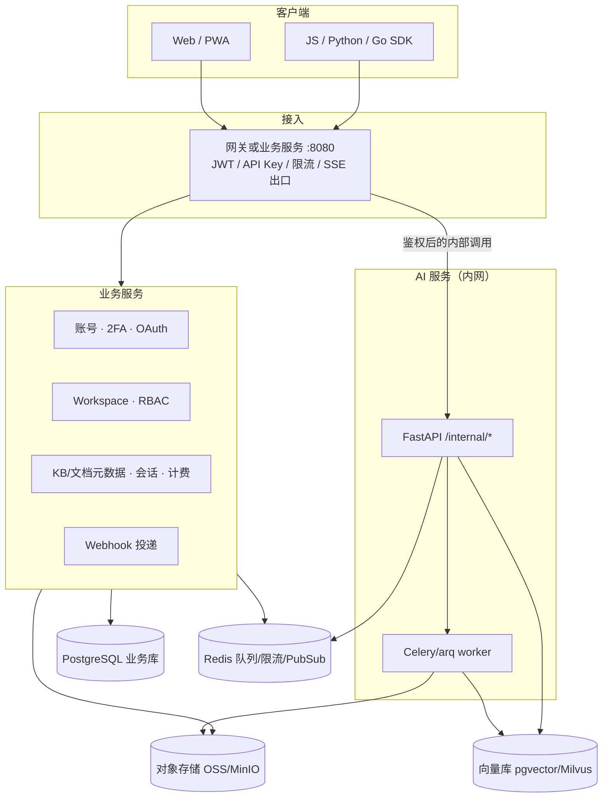

# 服务拆分实施手册（国内常见三层）

> 本文给出把当前 Next.js 单体拆成“业务服务 + Python AI 服务 + 前端”的可执行计划。计划覆盖每个阶段的工作拆分、接口、回滚与验收标准。当前生产架构仍以[总体架构](overview.md)为准；未完成对应阶段前，不要在运行时启用拆分路径。
>
> AI 辅助编写，已人工校核。

阅读后你应能：按阶段开工、按清单验收，并在任一步失败时回滚。回滚目标是上一阶段仍可用的单体（或上一稳定切面）。

## 背景与前置条件

当前系统是单仓库全栈：页面与 API 同在 Next.js 16 进程，[读路径以内存 Store 为事实源](adr/adr-0001-in-memory-store-write-through-db.md)。文档处理与 Agent 走[后台队列](adr/adr-0002-background-job-queue.md)，RAG 在 `src/lib/rag/`，租户边界是 [Workspace](adr/adr-0003-multi-tenant-isolation.md)。

国内常见拆法：

| 层 | 建议实现 | 承接现有模块 |
|----|----------|----------------|
| 前端 | 继续 React + TypeScript（不必为对齐国内而重写 Vue）<br/>**〔已被推翻〕**——2026-10 拍板 Vue 3 绞杀重写并已收官（V0-V8），见下文“前端替换”节 | 原 `src/app/(app)`、`src/components/`（已删除，Vue 等价物在 `frontend/`） |
| 业务服务 | Java 17+ Spring Boot，或 Go | `auth/` `workspace/` `team/` `billing/` `kb/`（元数据）`chat/`（会话）`apikeys/` `webhooks/`（投递）`proxy.ts`（限流） |
| AI 服务 | Python 3.12 + FastAPI + 独立 worker | `rag/` `llm/` `kg/` `external/` `agent/` |

前置：

- 已能 `pnpm dev` 走通登录 → 上传 → 问答；`pnpm lint` 与受影响测试可跑；
- 已阅读 [RAG 引擎](rag-engine.md)、[Agent 编排](agent-orchestration.md)、[部署指南](../ops/deployment-guide.md)；
- 冻结对外合同：现有 `/api/v1/*` 路径、SSE 事件名（`sources` / `token` / `done`；Agent 的 `init` / `step` / `done` / `error` / `end`）、API Key scope 在拆分期间**不得改名**。

两条实施轨道（选一条写进阶段计划，不要混用工期）：

| 轨道 | 做到哪一阶段 | 适用 |
|------|----------------|------|
| 简历 / 学习 | 阶段 0～3 完成即可演示“Python RAG + 现有 Next BFF” | AI 应用 / 全栈岗 |
| 生产 / Java 岗 | 做到阶段 4～6 | 国内 ToB、多实例、Java 后端简历 |

## 目标架构



**不可谈判的契约**（全程有效，写入每阶段验收）：

1. 浏览器只打业务入口（现有 Next 或拆出后的业务服务）。Python **不对公网**。
2. 调 AI 时由业务侧注入已校验的 `workspaceId` / `userId` / `kbId`。Python 不得自行解析用户 JWT 去列知识库。
3. 文件走对象存储；禁止再依赖 app 与 worker 共享 `.uploads` 本地卷作为跨进程协议。
4. SSE 事件名与 `/api/v1` 对外路径保持兼容，直到单独做 API 大版本。
5. 向量检索与权限校验都必须带 `workspace_id`，与 [ADR-0003](adr/adr-0003-multi-tenant-isolation.md) 一致。

## 阶段总览

| 阶段 | 名称 | 退出后的系统形态 | 建议工期（1 人） | 轨道 |
|------|------|------------------|------------------|------|
| 0 | 冻结合同与基线 | 仍是单体；有基线报告与特性开关 | 3～5 天 | 两条都要 |
| 1 | 绞杀：Python RAG | Next 仍对外；索引与问答生成走 Python | 2～4 周 | 两条都要 |
| 2 | 对象存储 | 上传直传 MinIO/OSS；worker 按 URL 拉取 | 1～2 周 | 两条都要 |
| 3 | AI 侧租户硬化 | 向量表带 `workspace_id`；越权检索失败 | 1 周 | 两条都要 |
| 4 | 拆业务服务 | Java/Go 接管鉴权与元数据；废弃内存读路径 | 4～12 周 | 生产轨道 |
| 5 | Agent 与 Webhook | Agent 在 Python；进度经 Redis；Webhook 仍由业务投递 | 2～4 周 | 生产轨道 |
| 6 | 前端解耦与多实例 | Next 可改为纯静态；多副本 + 网关 | 2～4 周 | 生产轨道 |

阶段必须**串行**。未关闭上一阶段验收清单，不得开始下一阶段。每个阶段结束必须能演示主路径，并保留回滚开关。

全局回滚原则：每个阶段用环境变量切换（如 `AI_SERVICE_URL` 空则走进程内 `src/lib/rag`）。开关默认关；验收通过后再在演示环境打开。

## 阶段细则

上表只保留“退出后的形态”与工期，便于排期与对表。各阶段的目标、范围、工作拆分、内部接口、切换步骤、回退开关与验收标准见[服务拆分阶段细则（阶段 0～6）](service-split-phases.md)。

---

## 跨阶段验收矩阵（总检）

阶段全部完成后，用下表做一次放行评审。任一项“生产轨道”失败则不得宣称拆分完成。

| ID | 断言 | 简历轨道 | 生产轨道 |
|----|------|----------|----------|
| G1 | 浏览器永不直连 Python | ✅ | ✅ |
| G2 | `/api/v1` 路径与 SSE 事件名兼容 | ✅ | ✅ |
| G3 | 跨租户检索 0 hits | ✅ | ✅ |
| G4 | 对象存储为文件唯一来源 | ✅ | ✅ |
| G5 | 业务读路径不是进程内存 map | 可选（Next 仍可 hydrate） | ✅ 必须 |
| G6 | 业务多副本 + Redis 撤销生效 | — | ✅ |
| G7 | Agent + Webhook 签名兼容 | — | ✅ |
| G8 | 关 AI 开关或停 AI 时有明确错误/回滚 | ✅ | ✅ |
| G9 | 密钥不进日志与前端 | ✅ | ✅ |
| G10 | 健康检查存活与就绪分离 | ✅ | ✅ |

## 测试资产（建议固定仓库布局）

```
services/ai/
  tests/test_tenant_isolation.py
  tests/test_sse_contract.py
  tests/test_ssrf.py
KnowledgeAI/          # 现仓库
  e2e/main-flow.spec.ts          # 每阶段结束必跑
  scripts/smoke/test-sdk.ts
  scripts/smoke/test-split-negative.sh   # 新增：跨租户 + 无内部 token
```

每阶段合并门禁最低集：

- 阶段 0～3：现有 `pnpm lint` + `pnpm test:unit` + e2e 主路径 + AI 租户负例；
- 阶段 4～6：再加上业务服务单测/集成测试与“代码搜索禁止 Store 读生产路径”。

## 风险与显式非目标

| 风险 | 缓解 |
|------|------|
| 双实现（TS RAG + Python RAG）行为漂移 | 阶段 1 用同一批夹具文档对比引用 id；尽快把 Node RAG 标为 deprecated |
| 内存 Store 与 DB 短暂不一致在拆分中被放大 | 阶段 4 直接以 DB 为准，不要“两个缓存再同步” |
| 一人并行三个仓库 | 严格串行阶段；简历轨道停在阶段 3 |
| 为“像大厂”上注册中心/网格 | 非目标；compose 内网 DNS 足够到阶段 6 |
| 前端重写拖垮拆分 | 已出清：Vue 3 绞杀重写 V0-V8 收官（V6 基线 28 页 + 后续新增，现 30 个页面），拆分只涉及后端，前端仍是纯 `/api` 消费者 |

## 相关文档

- [总体架构](overview.md)
- [RAG 引擎架构](rag-engine.md)
- [Agent 编排架构](agent-orchestration.md)
- [ADR-0001 内存存储 + 写穿 DB](adr/adr-0001-in-memory-store-write-through-db.md)
- [ADR-0002 后台任务队列](adr/adr-0002-background-job-queue.md)
- [ADR-0003 多租户隔离契约](adr/adr-0003-multi-tenant-isolation.md)
- [ADR-0006 读路径存储演进](adr/adr-0006-read-path-storage-evolution.md)
- [ADR-0007 队列背压](adr/adr-0007-queue-backpressure.md)
- [ADR-0008 AI 服务框架选型](adr/adr-0008-ai-service-framework.md)
- [ADR-0009 业务服务语言选型](adr/adr-0009-business-service-language.md)
- [API 使用指南](../api/guide.md)
- [Webhook](../api/webhooks.md)
- [部署指南](../ops/deployment-guide.md)
- [环境变量全表](../ops/env-vars.md)

## 修订记录

| 版本 | 日期 | 变更 |
|------|------|------|
| 1.0.0 | 2026-10-12 | 初版：国内三层拆法的七阶段工作包与验收标准 |
| 1.1.0 | 2026-10-12 | 修订：related 补齐 ADR-0006/Webhook；阶段 2 补环境变量 parity 要求；阶段 1 格式归属澄清；引入 ADR-0008（AI 服务框架选型） |
| 1.2.0 | 2026-10-13 | 阶段 1～6 全部实施完成：部署产物落库（docker-compose.split.yml 一键起 + 滚动发布、deploy/nginx.conf 网关、k8s/split.yaml 三服务清单）；阶段 6 演练实测暴露并修复 Tomcat 默认 30s 异步超时掐断 SSE（业务侧 spring.mvc.async.request-timeout 对齐网关）；ADR-0008 修订 1.1.0（Agent 队列 arq → 语言中立 Redis List） |
| 1.3.0 | 2026-10-16 | 阶段 6“可选 Vue3 重写”启动实施（V1）：frontend/ 认证/静态/分享 11 路由 + 网关绞杀切流机制（routes.conf + switch-frontend.sh，秒级回退）；共享资产单源复用，/api 契约冻结 |
| 1.4.0 | 2026-11-05 | 拆分以满足单篇 < 500 行的约定：阶段 0～6 的目标 / 范围 / 工作拆分 / 内部接口 / 切换步骤 / 验收标准移至[阶段细则](service-split-phases.md)，本文保留背景、目标架构、阶段总览、跨阶段验收矩阵、测试资产与风险 |
