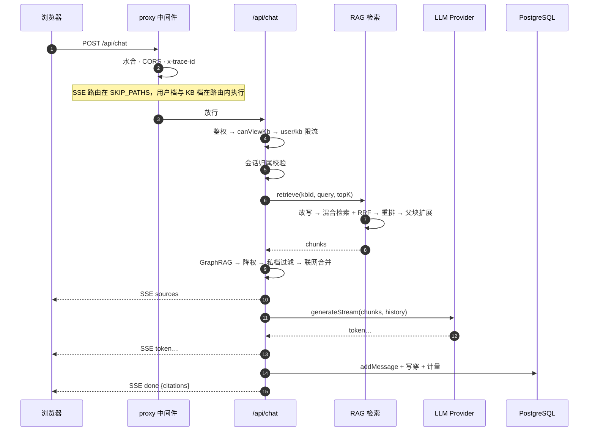
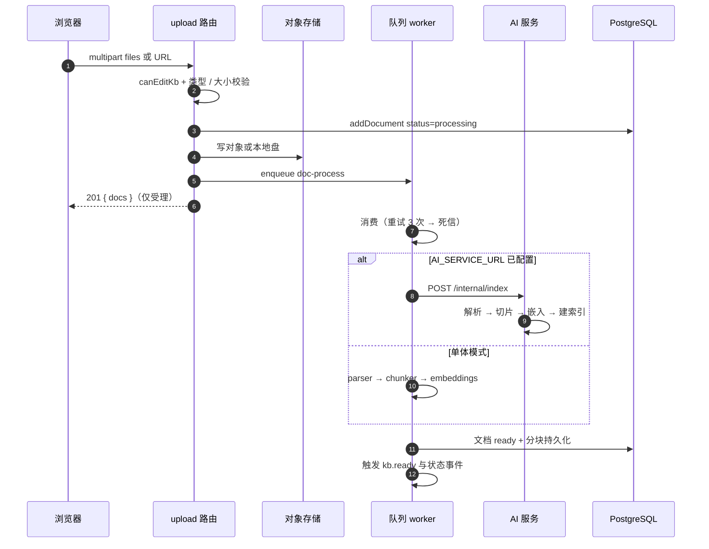
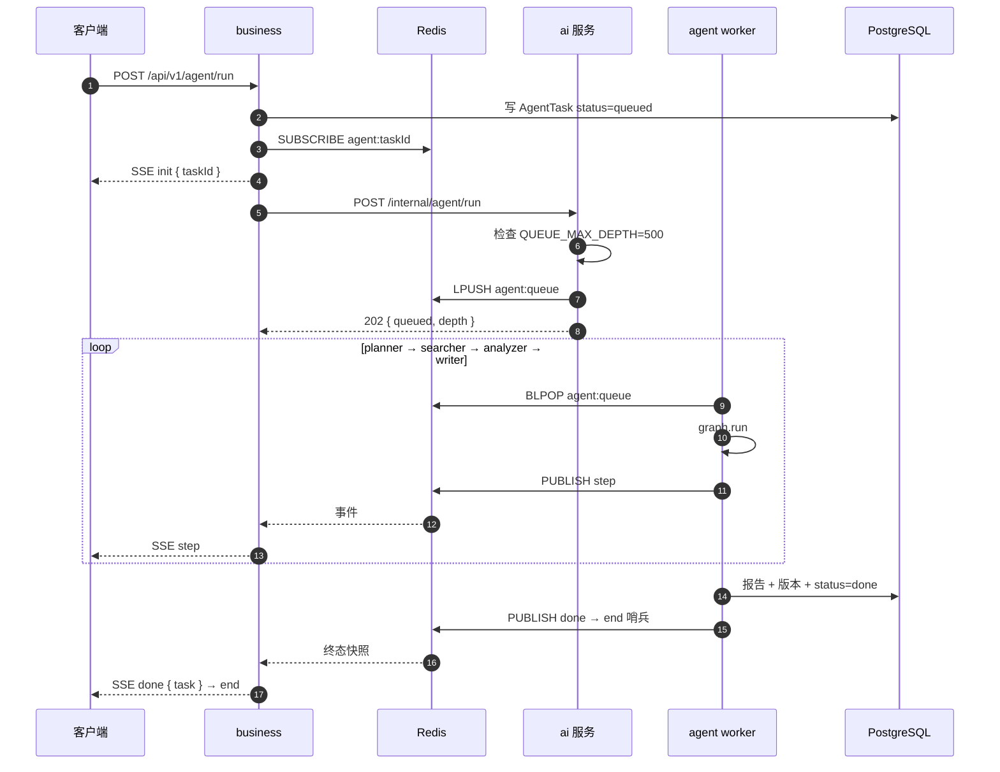
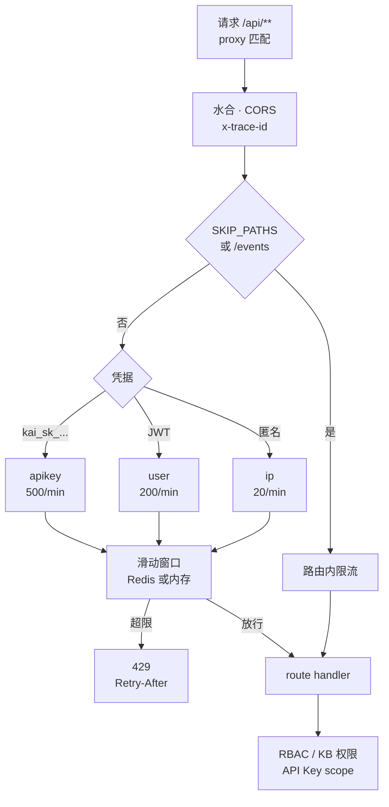

# 系统架构：数据流与契约

> 本文是[系统架构图与设计说明](system-design.md)的续篇，章节编号接着上篇（§6～§10）。上篇回答“系统由哪些部分构成”（上下文、部署拓扑、分层规则、模块地图、数据架构），本文回答“请求与数据怎样流动、哪些边界不能动”。
>
> 核对口径与上篇一致：这不是设计意图的复述，而是**对代码的一次快照核对**，数量、路径、事件名均可在仓库中复现——复核命令见上篇[附录 C](system-design.md#附录-c-如何复核本文)，核对日期 **2026-11-04**。RAG 算法细节见 [RAG 引擎架构](rag-engine.md)，Agent 图执行见 [Agent 编排架构](agent-orchestration.md)。

## 6. 关键数据流

### 6.1 智能问答（SSE）

- **事件顺序固定**：`sources` → `token*` → `done`，异常为 `error`；改名会打挂前端与 e2e；
- `AI_SERVICE_URL` 配置后，检索与生成改走 Python：BFF 先发 `sources`（用过滤后的 chunks），Python 的 `sources` 帧被跳过，事件名不变；
- **降级策略固定**：AI 服务不可用 → `503 + Retry-After`，**不静默回退本地 RAG**（避免同一问题两种质量）。

### 6.2 文档入库（上传 → 解析 → 索引）

关键点：**解析绝不占用请求线程**。上传接口只确认“已受理并入队”，就绪状态由文档状态 SSE / Webhook 通知；`QueueBackpressureError` 会把文档标记为失败并给出可重试提示，而不是 500。

### 6.3 Agent 调研任务（拆分形态）

单体形态是同一套语义的进程内版本：`enqueue("agent-run")` → worker 内存队列 → `publishAgentEvent` → EventEmitter → `run-handler` 转发。**两种形态共用事件名与帧格式**，因此前端与测试无需区分。

### 6.4 鉴权与限流

| 档位 | Key | 默认额度（次/分） | 执行位置 |
|------|-----|------------------|----------|
| 匿名 | `ip:<ip>` | 20 | proxy |
| 登录用户 | `user:<id>` | 200 | proxy（SSE 路由在 handler 内） |
| API Key | `apikey:<keyId>` | 500 | proxy |
| 知识库 | `kb:<kbId>` | 60 | 路由内（proxy 读不到 body） |
| 集成（机器人 / 挂件） | `integration:<id>` | 120 | 路由内 |
| Agent 运行 | `agent:<userId>` | 10 | 路由内（成本保护） |
| 邮箱类接口 | `email:<addr>:<endpoint>` | 3 | 路由内（防邮件轰炸） |
| 公开分享 | `ip:<ip>` | 60 | 路由内（防令牌爆破） |

`SKIP_PATHS` 共 12 条（4 条 SSE、1 个 webhook、通知轮询、`auth/me`、presence、公开分享、健康探针、bot 回调、OpenAPI），另有“任何以 `/events` 结尾”的后缀豁免。

## 7. 契约与边界

### 7.1 SSE 事件契约（冻结，勿改名）

| 链路 | 事件序列 | 载荷要点 |
|------|----------|----------|
| 问答 | `sources` → `token*` → `done`，异常 `error` | `sources` 带 chunks 摘要（前端实时渲染引用 chip）；`done` 带完整文本 / 引用 / messageId |
| Agent | `init` → `step*` → `done`，异常 `error` → `end` | `step` 含 role / status / progress / result；`done` 带任务终态快照 |
| 知识库 / 协作 / 通知 | 以 `/events` 结尾的长连接 | 变更事件；路由内自行限流 |

### 7.2 版本化 API 与作用域

- `/api/v1/**` 是**对外稳定面**：API Key 认证 + scope（如 `chat:read`、`agent:run`），`openapi/spec.ts` 是规范单一事实源；
- `/api/**` 是**内部面**：JWT 会话为主，供 Web 端使用；
- 新增 v1 端点必须同时更新 OpenAPI 规范（CI 有漂移检查）与 scope 表。

### 7.3 内部服务契约（业务 ↔ AI）

1. **只内网**：`/internal/*` 必须携带 `X-Internal-Token`；未配置令牌 = 全部 401(fail-closed)；
2. **身份由 BFF 注入**：Python 不解析用户 JWT、不做业务鉴权，只信任已校验的 `workspaceId`；
3. **租户双匹配**：索引、检索、删除都强制 `workspaceId` + `kbId`；归属不一致 → 400 / 403；
4. **线上帧格式一致**：`data: {"type": ...}\n\n`，业务侧可原样透传或重组 `done`；
5. **队列通道**：`agent:queue`(List)+ `agent:<taskId>`(Pub/Sub)，结束哨兵 `{ "type": "end" }`。

### 7.4 跨语言兼容（字节级）

密码哈希（PBKDF2 / legacy SHA-256）、JWT(HS256 claims)、API Key(AES-256-GCM + HKDF)、TOTP(RFC 6238)、Webhook 签名（HMAC-SHA256，`sha256=` + hex）均有双向测试向量；任何一侧改算法都属于破坏性变更。

### 7.5 错误与降级语义

| 场景 | 行为 |
|------|------|
| AI 服务不可用 | 检索 / 问答 `503` + `Retry-After: 30`，不静默回退 |
| AI 索引失败 | 队列重试 → 死信，文档保持 `processing` / `failed` |
| 队列积压 | `QueueBackpressureError`；调用方返回可重试提示；就绪探针 `queueBackpressured` |
| Redis 降级 | 限流 / 撤销退回单实例实现，就绪探针 `revocationDegraded` |
| 未登录 / 越权 | `401` / `403`，不泄露资源存在性 |
| 参数非法 | `400`，不落库、不计配额 |

## 8. 横切设计

### 8.1 可观测性

- **追踪**：`proxy` 生成 / 透传 `x-trace-id` → 路由 `withApiTrace` → `withSpan("rag.retrieve")` → 远端 `X-Trace-Id`，形成跨进程 span 树；超阈值 `slow` 标记暴露在 `/admin/monitoring/traces`；
- **日志**：pino JSON，Edge 侧用 `log-edge.ts`(console JSON)，字段经 `redact.ts` 脱敏；
- **指标**：问答 / 索引 / 限流 / 队列计数在 `obs/metrics.ts`，管理端看板读取；
- **探针**：`/api/health`（存活，与依赖解耦）与 `/api/health/ready`（DB / Redis / LLM + 降级位，失败 503）；
- **错误上报**：Sentry，由 `SENTRY_DSN` 门控；前端有 `error-reporter.ts`。

### 8.2 安全边界

| 面 | 机制 |
|----|------|
| 认证 | JWT（HS256，`kai-token` cookie / Bearer）+ API Key（`kai_sk_`）+ OAuth + TOTP 2FA |
| 授权 | 平台级 `User.role`(owner / admin / editor / viewer)+ 工作区 Team 角色 + KB `access`(view / edit / private) |
| 会话吊销 | jti 黑名单（Redis 共享，跨副本生效） |
| CORS | 生产必须显式 `CORS_ALLOWED_ORIGINS`；未配置不反射 Origin |
| SSRF | 模型自定义 `baseUrl` 与外部抓取统一 fail-closed，云元数据地址永久封禁 |
| 比较 | 令牌 / 分享密码 / API Key 比较恒定时间化 |
| 审计 | 哈希链审计日志（`security/audit.ts`）+ 登录事件 + 管理端查询 |

### 8.3 可靠性与背压

- 队列两种实现：内存（默认，单实例）与 BullMQ（多实例、DLQ、独立 worker）；
- 任务类型 5 种：`doc-process`、`agent-run`、`index-cleanup`、`webhook-deliver`、`email-send`；
- 积压阈值 `QUEUE_MAX_DEPTH=500`（按队列计）；webhook 等尽力而为路径跳过并记录；
- 网关对非 SSE 请求做副本故障重试（`proxy_next_upstream error timeout http_502 http_503`），对 SSE 关闭缓冲并放宽超时。

### 8.4 性能特征

| 路径 | 成本 | 优化手段 |
|------|------|----------|
| 读业务数据 | 内存 Map | 零 DB 往返；水合一次 |
| 问答首 token | 检索 + LLM 网络 | 多查询并行、候选池裁剪、SSE 尽早发 `sources` |
| 文档索引 | 解析 + 嵌入 | 全异步队列、批量嵌入、失败重试 |
| 长连接 | 每连接一个流 | 网关不缓冲、客户端断开即取消上游 fetch |

## 9. 演进现状与风险

| 编号 | 风险 | 影响 | 建议 |
|------|------|------|------|
| R1 | **拆分覆盖不完整**：Java 只实现 27 个端点，网关 `location /api/` 却全量指向 business | 拆分拓扑下未迁移路由（计费、管理端、通知、分片上传等）不可达 | 切流前按路由前缀分批，或让网关对未迁移前缀回落 `app` |
| R2 | **双迁移工具**：Prisma 25 个迁移 + Flyway V1–V21 | schema 漂移无人察觉 | 以 `prisma/schema.prisma` 为唯一事实源，Flyway 只读校验并纳入 CI 漂移检查 |
| R3 | **双 RAG 实现**（TS 进程内 / Python 远端） | 行为漂移，同一问题两种质量 | 保持同一批夹具对比引用 id；明确 TS 路径为回退 |
| R4 | **内存读路径与多副本** | 多副本读不一致 | 除鉴权外按 ADR-0009 迁移到 DB 读路径；过渡期强制单实例 |
| R5 | **文档数字漂移**（迁移数 / 页面数） | 评审依据失真 | 本文附录 C 的命令纳入季度核对 |

## 10. 扩展指南：新增一个领域实体

按现有约束，新增持久化实体必须**同时**改动 4 处，漏一处即内存 / DB 失步：

1. `prisma/schema.prisma` + `npx prisma migrate dev --name <descriptive>`；
2. 领域 store（`src/lib/<domain>/store.ts`，含 `globalThis` 单例与 CRUD）；
3. `src/lib/db/persist.ts`（写穿函数）；
4. `src/lib/db/hydrate.ts`（水合函数）。

随后按需补：`src/app/api/<domain>/route.ts`（薄接口）→ `frontend/src/api/<domain>.ts`（领域客户端）→ `frontend/src/views/**`（页面）→ `.test.ts` / `scripts/smoke/test-*.ts`。若涉及新环境变量，`.env.example` 与 `docs/ops/env-vars.md` 必须同步（CI 有 parity 检查）。

## 修订记录

| 版本 | 日期 | 变更 |
|------|------|------|
| 1.0.0 | 2026-11-04 | 自 [系统架构图与设计说明](system-design.md) 1.0.1 拆出 §6～§10（数据流、契约、横切、演进风险、扩展指南），以满足单篇 < 500 行 |
| 1.0.1 | 2026-11-05 | 修正 `SKIP_PATHS` 构成：webhook 为 1 个（`/api/billing/webhook`）而非 2 个，与 `src/proxy.ts` 的 12 条一致 |
