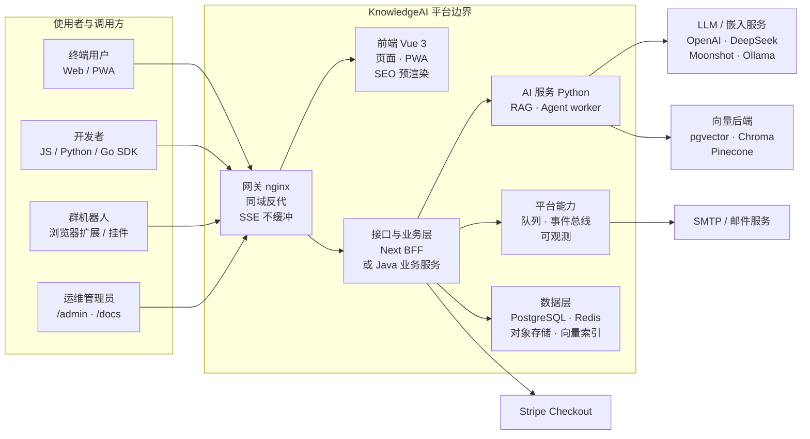
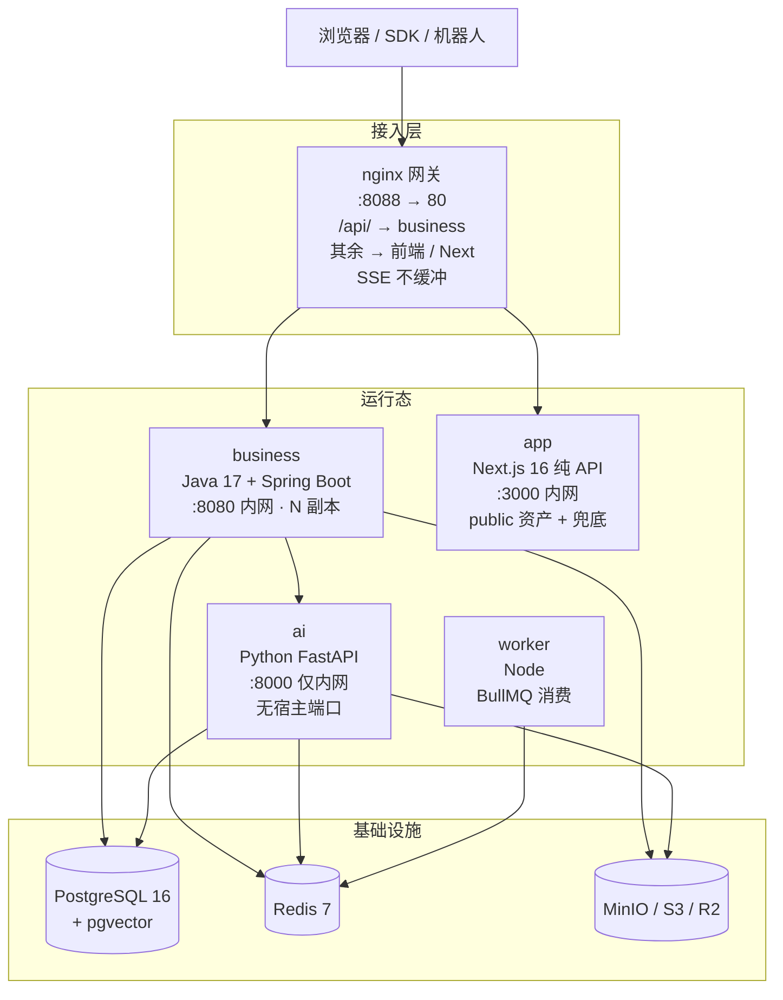
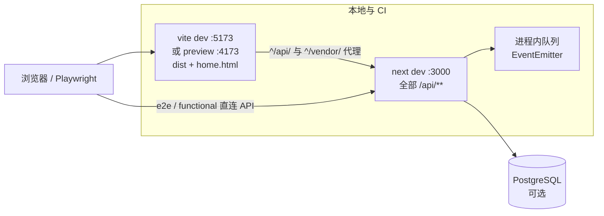
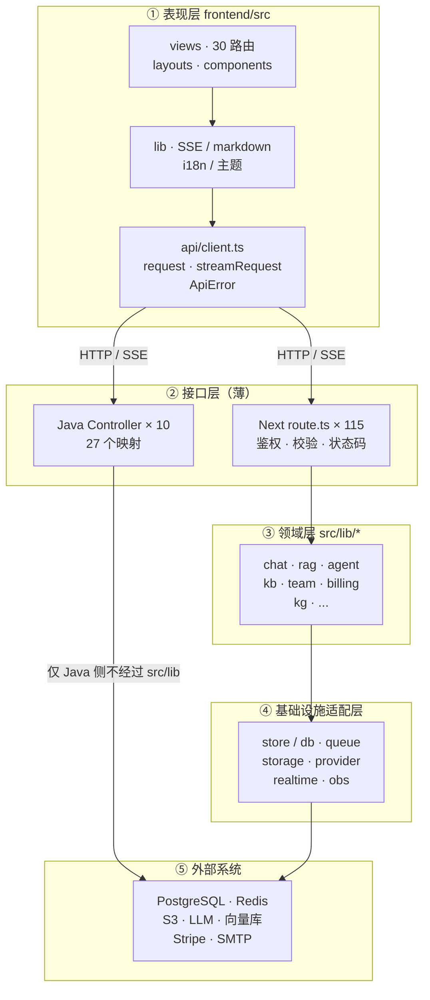
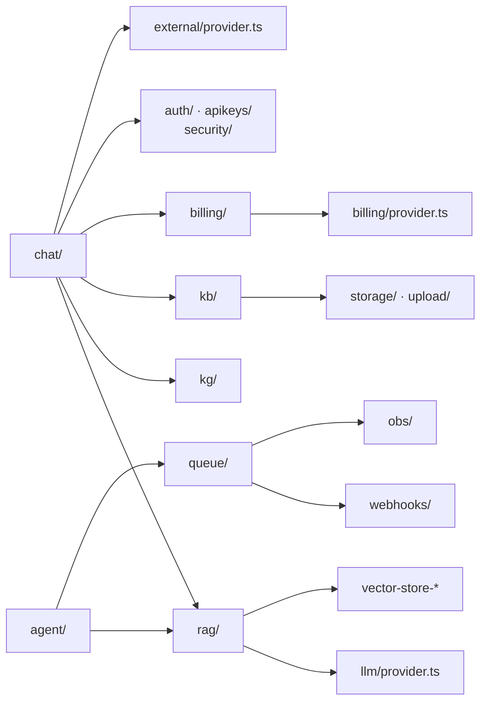
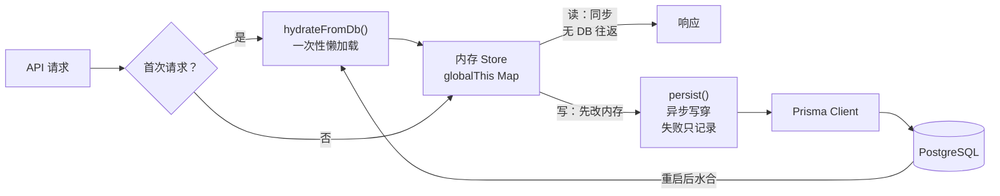

# 系统架构图与设计说明

> 本文回答“**系统由哪些部分构成**”（上下文、部署拓扑、分层规则、模块地图、数据架构）；“请求与数据怎样流动、哪些边界不能动”见续篇 [系统架构：数据流与契约](system-design-runtime.md)。
>
> 与 [总体架构](overview.md) 的分工：overview 讲“为什么这样设计”（决策与权衡），本文讲“当前代码长什么样”（可核对的现状）。RAG 算法细节见 [RAG 引擎架构](rag-engine.md)，Agent 图执行见 [Agent 编排架构](agent-orchestration.md)，拆分步骤见 [服务拆分实施手册](service-split.md)。

## 0. 本文定位与核对口径

本文不是设计意图的复述，而是**对代码的一次快照核对**。所有数量、路径、事件名均可在仓库中复现（命令见 [附录 C](#附录-c-如何复核本文)），核对日期 **2026-11-04**。

| 维度 | 核对结果 | 证据位置 |
|------|----------|----------|
| 前端 | Vue 3 + Vite，**30 个页面路由**（另 1 条 404 兜底） | `frontend/src/router/index.ts` |
| 接口层 | Next.js 16 App Router，**115 个 `route.ts`** | `src/app/api/**/route.ts` |
| 领域层 | `src/lib/` **33 个子目录** + 8 个顶层工具文件 | `src/lib/` |
| 数据模型 | Prisma **29 个 model**，**25 个迁移目录** | `prisma/schema.prisma`、`prisma/migrations/` |
| 拆分服务 | Java 17 业务服务（**10 个控制器 / 27 个映射**）+ Python FastAPI | `services/business`、`services/ai` |
| 部署产物 | compose **9 个服务**；k8s 四组工作负载 | `docker-compose.split.yml`、`k8s/split.yaml` |
| 契约测试 | Python pytest 约 **34 例**；Node 侧 `tests/` + `scripts/smoke/` | `services/ai/tests/`、`scripts/smoke/` |

**与既有文档的两点口径**：

1. 页面数、迁移数、切流条数已全站对齐——`AGENTS.md`、README、`overview.md`、`service-split.md` 均按 **30 个页面路由 / 25 个迁移目录 / 28 条切流规则**书写；再发现不一致时，以[附录 C](#附录-c-如何复核本文)的命令为准（复核日期见上）。
2. 拆分形态的 Java 业务服务只覆盖 **27 个端点**，而 Next 侧有 115 个路由。因此**拆分拓扑只覆盖核心链路，不是全量 API**（见续篇 [§9 风险 R1](system-design-runtime.md#_9-演进现状与风险)）。

## 1. 系统上下文（C4-L1）



要点：

- **浏览器永不直连 Python**：AI 服务只接受业务侧带 `X-Internal-Token` 的 `/internal/*` 调用；
- **同域**：网关把页面与 API 放在同一域名下，Cookie 不跨域，CORS 只为“API + Widget / 扩展”这类跨源调用保留白名单；
- **外部依赖全部可选**：未配置即回退演示实现，详见 §3.1 依赖规则第 4 条。回退映射：LLM → 抽取式生成，向量库 → 内存索引，S3 → 本地盘，Redis → 进程内。

## 2. 部署拓扑（C4-L2）

### 2.1 生产三服务形态（>=1.3.0）



| 部署单元 | 技术栈 | 端口 | 对外暴露 | 副本 | 职责 |
|----------|--------|------|----------|------|------|
| `gateway` | nginx | `${GATEWAY_PORT:-8088}` → 80 | 是 | 1 | 路由、SSE 不缓冲、副本故障重试 |
| `business` | Java 17 + Spring Boot | 8080 | 否 | ≥2(k8s) | 鉴权、租户、问答编排、Agent、审计、用量 |
| `app` | Next.js 16（纯 API） | 3000 | 否 | 1 | 未迁移 API、`public/` 单源静态资产、前端兜底 |
| `ai` | Python + FastAPI | 8000 | 否 | 1（可扩） | 解析、切片、嵌入、检索、生成、Agent worker |
| `worker` | Node（esbuild 打包 `worker.ts`） | — | 否 | 1 | BullMQ 队列消费（`doc-process` 等） |
| `redis` | Redis 7 | 6379 | 否 | 1 | 限流滑窗、jti 撤销、`agent:queue`、Pub/Sub |
| `postgres` | pgvector/pg16 | 5432 | 否 | 1 | 唯一持久化事实源 |
| `minio` + `minio-init` | MinIO | 9000 / 9001 | 9000 | 1 | 对象存储（初始化 bucket） |

生产切流还有一层“前端绞杀”：`deploy/nginx/routes.conf` 的 **28 条规则**（23 个精确路径 + 5 个通配，含首页 `/`）由 `scripts/deploy/switch-frontend.sh` 生成 `frontend-switch.conf`。该文件决定某条页面路径走 Vue 静态还是回退 Next。回退是秒级的，因为只改 include 文件并 reload。

### 2.2 开发与 CI 形态（单体 + 双基址）



- 页面检查（Playwright 根套件、smoke `ui` 组）打 **:4173** 的 `vite preview`，API 流程打 **:3000**；
- 代理必须写成 `^/api/` 正则——字符串前缀 `"/api"` 会把 `/api-keys` 页面也代理到 Next；
- 未配 `DATABASE_URL` / `REDIS_URL` 时，整套系统以“内存 Store + 内存队列”运行，这是演示模式的默认形态。

## 3. 分层架构与依赖规则

### 3.1 五层视图



> 拆分形态下 Java 不经过 `src/lib`，它直接 `JdbcTemplate` 读 PostgreSQL，并调用 Python `/internal/*`；上图的 `J --> X` 表示这条独立路径。

**依赖规则（可在评审中直接引用）**：

1. **接口层不碰 ORM**：`src/app/api/**/route.ts` 中 `grep -c prisma` = **0**，持久化只能经 `src/lib/db/*` 或领域 store；
2. **接口层不写业务规则**：路由只做“取用户 → 校验归属 → 限流 → 调 `lib` → 序列化”，复用入口如 `handleChatRequest`、`handleAgentRun`；
3. **领域层不依赖 Next**：`src/lib/**` 不 import `next/server`，因此可被 worker、脚本、测试直接调用；
4. **外部实现藏在适配器后**：`llm/provider.ts`、`billing/provider.ts`、`external/provider.ts`、`rag/vector-store-*.ts`、`queue/*-queue.ts`、`storage/s3.ts` 是同层可替换实现，切换只由环境变量决定；
5. **共享资产单源**：前端 i18n、SSE 解析、主题引擎经 `@shared` 指向 `src/lib`，禁止拷贝（Vue 与 Next 共用一份）。

### 3.2 模块依赖（只列主要边）



箭头 = 编译期 import 方向。为可读性只保留主要边：`chat/` 还依赖 `models/`、`notifications/`，`kb/` 还依赖 `team/`、`db/`，所有领域模块的持久化统一经 `db/hydrate.ts` 与 `db/persist.ts`（图上省略）。

## 4. 核心模块地图

### 4.1 前端 `frontend/src`

| 目录 | 内容 | 说明 |
|------|------|------|
| `views/` | 31 个 `.vue`，对应 30 条页面路由 | 认证 6、静态 3、分享 3、工作台与业务页其余 |
| `api/` | `client.ts` + 15 个领域客户端 | 统一 `fetch` 封装；401 统一跳登录（豁免 `/api/auth/`、`/api/share/`、`/api/agent/public/`） |
| `lib/` | `event-stream.ts`、`kb-events.ts`、`presence.ts`、`markdown.ts`、`agent-dag.ts`、`chat-citations.ts`、`i18n.ts` 等 | SSE 解析、引用渲染、DAG 可视化、i18n |
| `components/` `layouts/` | AppShell、AuthLayout、业务组件 | `meta.shell` / `meta.auth` 决定外壳 |
| `stores/` | Pinia（`theme.ts`） | 跨页状态另有 `lib/workspace-store.ts` |
| `pwa/` | `sw-register.ts` | 仅生产注册，`public/sw.js` 预缓存未认证壳 |
| `prerender/` | SSR 预渲染入口 | 构建期产出 `dist/home.html` 保 SEO |

### 4.2 接口层（Next BFF，115 个路由）

| 功能域（路由数） | 代表端点 |
|------------------|----------|
| 知识库（14） | `knowledge-base/[id]/upload`、`.../reindex`、`.../graph`、`.../share` |
| **版本化 `/api/v1`（13）** | `v1/chat`、`v1/agent/run`、`v1/knowledge-bases/**`、`v1/webhooks/**`、`v1/integrations/**` |
| 认证 / 账号（12） | `auth/login`、`auth/me`、`auth/2fa-enroll`、`auth/oauth/*` |
| Agent（11） | `agent/run`(SSE)、`agent/tasks/[id]`、`.../export`、`agent/public/[id]` |
| 管理后台（11） | `admin/users`、`admin/monitoring`、`admin/ratelimit`、`admin/audit` |
| 团队 / 工作区（11） | `team/invite`、`team/kb-access`、`team/presence/events`、`workspaces` |
| 聊天（7） | `chat`(SSE)、`chat/conversations/[id]`、`.../events`、`.../shared` |
| 安全 / 隐私（6） | `security/2fa`、`security/export`、`security/sessions/[id]` |
| 计费 / 用量（6） | `billing/checkout`、`billing/webhook`、`usage` |
| 上传 / 文件（5） | `upload/chunk/init`、`upload/chunk/[uploadId]`、`files/[key]` |
| 模型 / 通知（8） | `models`、`models/test`、`notifications/events`、`notifications/preferences` |
| 健康 / 可观测（4） | `health`、`health/db`、`health/ready`、`obs/report` |
| API Key / 搜索 / 规范（5） | `api-keys`、`api-keys/[id]`、`api-keys/logs`、`search`、`openapi.json` |
| 公开分享（2） | `share/doc/[token]`、`share/kb/[token]` |

`/api/v1/*` **不重复实现**：`v1/chat` 与 `v1/agent/run` 分别复用 `handleChatRequest`、`handleAgentRun`，只在外层加 API Key scope 校验；因此两条链路的 SSE 事件名天然一致。

### 4.3 领域层 `src/lib`（33 个子目录，按职责分组）

| 分组 | 模块 | 职责 |
|------|------|------|
| 检索与生成 | `rag/`、`chat/`、`kg/`、`llm/`、`models/` | 解析 / 切片 / 嵌入 / 混合检索 / 重排 / 生成；GraphRAG；模型配置与上下文窗口 |
| 编排与异步 | `agent/`、`queue/`、`realtime/` | StateGraph 编排、任务队列、SSE 连接与 presence |
| 知识与协作 | `kb/`、`collab/`、`team/`、`workspace/`、`notifications/` | 知识库 / 文档 / 分享、文档协同编辑（Yjs 状态与同步）、RBAC 与邀请、工作区、站内通知 |
| 账号与安全 | `auth/`、`apikeys/`、`security/`、`validation/` | JWT / 会话 / OAuth / 2FA、API Key 与 scope、CORS / SSRF / TOTP / 审计哈希链 |
| 计费与运营 | `billing/`、`usage`（`store` 内）、`admin/`、`marketing/` | 订阅 / 发票 / 订单、用量日聚合、管理端聚合、首页 readiness |
| 集成与出站 | `webhooks/`、`integrations/`、`external/`、`email/`、`voice/` | Webhook 签名投递、机器人、Confluence / Notion / Web / arXiv / GitHub、邮件、STT / TTS |
| 平台能力 | `db/`、`storage/`、`upload/`、`obs/`、`health/`、`i18n/`、`theme/`、`openapi/` | 水合与写穿、对象存储、分片上传、追踪 / 日志 / 指标、就绪探针、服务端翻译、品牌色、OpenAPI 生成 |

### 4.4 拆分服务

**Java 业务服务**（`services/business`，`@Profile("pg")`）：

| 包 | 内容 |
|----|------|
| `auth/` | `AuthController`、`JwtAuthFilter`、`KaiJwtService`、`ApiKeyService`、`TotpService`、`JtiRevocationService`、`LoginLockoutService`、`Pbkdf2PasswordService` |
| `tenant/` | `KbController`、`TeamMemberController`（租户内 RBAC） |
| `kb/` | `KbWriteController`（文档写入 / 删除 / 分享 / 状态） |
| `chat/` | `ChatController`、`SseFrameParser`（透传 Python 流并补 `messageId` / `conversationId`） |
| `agent/` | `AgentController`、`AgentEventBus`、`WebhookService` |
| `audit/` `usage/` `ratelimit/` `share/` `health/` `ai/` | 审计、用量、限流过滤器、公开分享、探针、`AiClient` |

**Python AI 服务**（`services/ai`）：

| 模块 | 职责 |
|------|------|
| `main.py` | FastAPI 入口；`/health` + `/internal/{index, retrieve, chat/stream, agent/run, testing/reset}` |
| `parser.py` `chunker.py` `embeddings.py` | 多格式解析、切片、嵌入（可回退本地哈希向量） |
| `retrieval.py` `bm25.py` | 混合检索（向量 + BM25），**强制 `workspace_id` + `kb_id` 双匹配** |
| `generation.py` | 流式生成与引用组装 |
| `agent.py` `agentqueue.py` | Agent 图执行；Redis List `agent:queue` 消费 + Pub/Sub 进度发布 |
| `store.py` `settings.py` `external.py` | 索引存储、配置、外部源抓取（含 SSRF 基线） |

## 5. 数据架构

### 5.1 存储职责矩阵

| 存储 | 角色 | 关键约束 |
|------|------|----------|
| PostgreSQL(Prisma) | **持久化事实源**；拆分形态下也是业务读路径唯一来源 | 改实体必须同时改 schema + 迁移 + `persist.ts` + `hydrate.ts` |
| 内存 Store（`globalThis`） | 单体形态的**读路径事实源** | 多副本不共享；鉴权读路径例外（回源 DB + Redis） |
| Redis | 限流滑窗、JWT jti 黑名单、`agent:queue`、Pub/Sub、BullMQ | 未配置时降级为单实例内存实现，并在就绪探针暴露降级位 |
| 对象存储（S3 / MinIO / 本地） | 原始文件 | 预签名 TTL ≤ 15 分钟；本地盘仅单体回退 |
| 向量索引（pgvector / Chroma / Pinecone / 内存） | 分块向量 + BM25 语料 | 检索必须带租户与 KB 过滤 |
| 进程内 EventEmitter / Redis Pub/Sub | SSE 事件总线 | 事件名冻结，见续篇 [§7 契约与边界](system-design-runtime.md#_7-契约与边界) |

### 5.2 数据模型（29 个 model）

| 域 | 模型 |
|----|------|
| 身份与租户 | `User`、`UserSecurity`、`Team`、`TeamMember`、`TeamInviteReservation`、`Workspace` |
| 知识 | `KnowledgeBase`、`KbDocument`、`KbChunk`、`KnowledgeEntity`、`KnowledgeRelation` |
| 对话与任务 | `Conversation`、`Message`、`AgentTask` |
| 计费与凭据 | `Subscription`、`Invoice`、`Order`、`ApiKey`、`UsageDaily`、`UserUsageDaily` |
| 安全与审计 | `SecurityAudit`、`LoginEvent`、`AuditLog` |
| 集成与配置 | `Notification`、`NotificationPrefs`、`WebhookSubscription`、`BotIntegration`、`ModelConfig`、`SystemConfig` |

迁移现状：Prisma **25 个目录**（`20260713022119_init` → `20261104120000_document_version`），Java 侧另有 **Flyway V1–V21**。两套迁移工具指向同一个 schema，是当前最需要关注的演进风险（续篇 [§9 R2](system-design-runtime.md#_9-演进现状与风险)）。

### 5.3 读写路径与一致性



设计后果（有意为之）：

- 读路径零 DB 往返，单实例下 Map 查找 < 1ms；
- 写穿失败只记日志不抛错，因此**内存与 DB 存在最终一致窗口**；
- 多实例下各实例读各自内存。除 apiKey 校验与 jti 撤销已共享化（ADR-0006）外，其余读路径仍要求单实例，或后续迁移到 DB(ADR-0009)。

## 接下来：数据流与契约

本文只讲了“系统由哪些部件构成”。**请求与数据怎样流动**、**哪些边界不能动**见续篇 [系统架构：数据流与契约](system-design-runtime.md)：四条主链路（问答 SSE / 文档入库 / Agent 调研 / 鉴权限流）、SSE 与内部服务契约、横切设计、演进风险 R1～R5，以及新增领域实体的扩展指南。

## 附录 A：目录速查

```text
KnowledgeAI/
├── src/
│   ├── app/api/          # 115 个 route.ts（Next BFF）
│   ├── lib/              # 33 个领域 / 平台模块
│   └── proxy.ts          # /api/* 中间件：水合 · CORS · 追踪 · 限流
├── frontend/             # Vue 3 + Vite（30 页面路由 / PWA / 预渲染）
├── services/
│   ├── business/         # Java 17 业务服务（10 控制器 / Flyway V1–V21）
│   └── ai/               # Python FastAPI（/internal/* + Agent worker）
├── prisma/               # 29 model / 25 迁移
├── deploy/               # nginx.conf · routes.conf（28 条切流规则）
├── k8s/split.yaml        # 三服务 + 网关清单
├── scripts/smoke/        # 验收套件（lib / limits / http / ui / infra）
├── tests/                # functional / api / performance
└── e2e/                  # Playwright 主流程
```

## 附录 B：端口与开关

| 端口 | 归属 |
|------|------|
| 8088 | 网关（宿主机映射到容器 80） |
| 3000 | Next API（开发 / 单体） |
| 5173 | Vite dev |
| 4173 | Vite preview（页面验收） |
| 9000 / 9001 | MinIO API / 控制台 |
| 8000 / 8080 | AI 服务 / 业务服务（仅容器网络） |

| 环境变量 | 作用 |
|----------|------|
| `AI_SERVICE_URL` | 空 = 进程内 RAG；非空 = 走 Python（失败返回 503） |
| `AI_INTERNAL_TOKEN` | `/internal/*` 唯一凭据，未配 = 全部 401 |
| `DATABASE_URL` | 空 = 纯内存模式 |
| `REDIS_URL` | 空 = 内存限流 / 内存队列 |
| `VECTOR_STORE` | `pgvector` / `chroma` / `pinecone` / 缺省内存 |
| `S3_*` | 对象存储；缺省本地盘 |
| `QUEUE_MAX_DEPTH` | 队列积压阈值（默认 500） |
| `CORS_ALLOWED_ORIGINS` | 跨源白名单；生产未配置则不反射 |

## 附录 C：如何复核本文

```bash
find src/app/api -name route.ts | wc -l                  # 115
ls -d src/lib/*/ | wc -l                                 # 33
grep -c "^model " prisma/schema.prisma                   # 29
ls -d prisma/migrations/*/ | wc -l                       # 25
grep -rl "prisma" src/app/api --include=route.ts | wc -l  # 0（接口层不直连 ORM）
grep -c "path:" frontend/src/router/index.ts              # 31（含 404 兜底）
wc -l < deploy/nginx/routes.conf                          # 28
grep -rhoE '@(Get|Post|Put|Delete|Patch)Mapping' services/business/src/main/java | wc -l  # 27
```

## 修订记录

| 版本 | 日期 | 变更 |
|------|------|------|
| 1.0.0 | 2026-11-04 | 初版：按代码核对生成 C4 上下文 / 容器拓扑、五层依赖规则、模块地图、数据模型、四条数据流、契约与风险清单 |
| 1.0.1 | 2026-11-04 | 图表标签改为显式换行，修复 CJK 字体下 Mermaid 节点文字被裁剪的问题；模块依赖图去掉子图以降低连线交叉 |
| 1.1.0 | 2026-11-04 | 拆分以满足单篇 < 500 行的约定：§6～§10（数据流、契约、横切、演进风险、扩展指南）移至续篇 [系统架构：数据流与契约](system-design-runtime.md)，本文保留 §0～§5 与附录；同时修正核对数字（`src/lib` 32→33，补 `collab/`；切流规则改为 23 精确 + 5 通配，合计 28）并对齐附录 C 的复核命令 |
